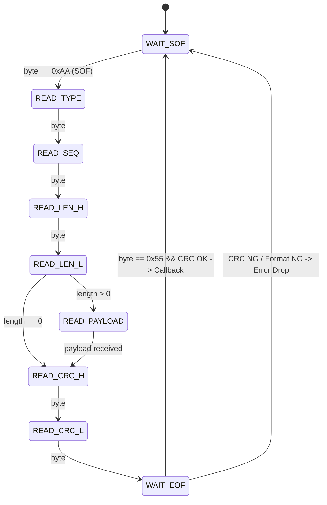

# uart_protocol (組み込み向けUART通信プロトコルスタック)

`uart_protocol` は、マイコン間通信やPC-マイコン間通信などのUARTシリアル通信において、高い信頼性と耐ノイズ性を提供する軽量プロトコルスタックライブラリです。

---

## 📑 目次
1. [特徴とメリット](#-特徴とメリット)
0. [再同期・タイムアウト・ARQ](#-再同期タイムアウトarq)
2. [フレーム構造とパケット仕様](#-フレーム構造とパケット仕様)
3. [パーサーステートマシン](#-パーサーステートマシン)
4. [C API リファレンス](#-c-api-リファレンス)
5. [C++ API リファレンス](#-c-api-リファレンス-1)
6. [リングバッファ (FIFO)](#-リングバッファ-fifo)
7. [実装例・ユースケース](#-実装例ユースケース)

---

## 🎯 特徴とメリット

- **ストリーム駆動ステートマシン**: 1バイト受信（UART割込みハンドラ `USART_IRQHandler` 等）から直接パーサーを駆動可能。
- **高信頼エラー検出**: CRC-16-CCITT（`embed_crc` を使用。`EMBED_CRC_TABLES=ON` でテーブル駆動）により、伝送路上のノイズやビット化けを検出・破棄。
- **再同期**: ノイズの `0xAA` を SOF と誤認しても、失敗時に受信済みバイトを再走査して後続の正しいフレームを取りこぼしません。
- **受信タイムアウト**: フレーム途中で受信が途絶えたら破棄・再走査（`uart_proto_set_rx_timeout` + `uart_proto_poll`）。
- **確実な配送 (ARQ)**: `uart_arq` で ACK 待ち・タイムアウト再送・重複排除（Stop-and-Wait）。
- **軽量・ゼロ動的メモリ**: 静的バッファで動作し、`malloc` / `free` を一切使用しません。
- **標準パケットタイプ完備**: データ (`DATA`)、肯定応答 (`ACK`)、否定応答 (`NACK`)、疎通確認 (`PING`/`PONG`)、コマンド/レスポンス (`COMMAND`/`RESPONSE`) を標準サポート。
- **C/C++両対応**: 組み込みC言語APIに加え、ラムダ式で送受信ハンドラを記述できるモダンC++ラッパーを提供。

---

## 📦 フレーム構造とパケット仕様

```text
+------+------+------+------------+----------------+------------+------+
| SOF  | TYPE | SEQ  | LEN (2B)   | PAYLOAD (0..N) | CRC16 (2B) | EOF  |
| 0xAA | (1B) | (1B) | (Big-End)  | (LEN bytes)    | (Big-End)  | 0x55 |
+------+------+------+------------+----------------+------------+------+
```

| フィールド | バイト長 | 説明 |
| :--- | :--- | :--- |
| **SOF (Start of Frame)** | 1 | フレーム開始バイト (`0xAA`) |
| **TYPE** | 1 | パケット種別 (`0x01`: DATA, `0x02`: ACK, `0x04`: PING 等) |
| **SEQ** | 1 | シーケンス番号 (0〜255) |
| **LEN** | 2 | ペイロード長 (ビッグエンディアン, 最大 `UART_PROTO_MAX_PAYLOAD` = 既定 512 バイト) |
| **PAYLOAD** | 可変 (0〜512) | 送信バイナリデータ |
| **CRC16** | 2 | TYPE〜PAYLOAD末尾までの CRC-16-CCITT |
| **EOF (End of Frame)** | 1 | フレーム終了バイト (`0x55`) |

フレーム長はペイロード長 + 8 バイト（`UART_PROTO_OVERHEAD_SIZE`）です。
旧版はこの定数を 7 と誤って定義しており、最大長のペイロード送信時に内部の送信バッファを
1 バイト超えて書き込んでいました（修正済み）。

最大ペイロード長は CMake の `-DUART_PROTO_MAX_PAYLOAD=<1..65535>` で変更できます
（構造体サイズが変わるため、ライブラリと利用側に同じ値が PUBLIC 定義として伝わります）。
`uart_protocol_t` は再走査用に最大フレーム長ぶんの受信バッファを持つため、
RAM が厳しい場合はペイロード長を小さくしてください。

---

## 🔄 パーサーステートマシン



---

## 📖 C API リファレンス

### 初期化
```c
void uart_proto_init(uart_protocol_t *proto, uart_proto_tx_fn tx_fn, uart_proto_rx_callback rx_cb, void *user_data);
```

### 送信
```c
bool uart_proto_send(uart_protocol_t *proto, uint8_t type, const uint8_t *payload, uint16_t payload_len);
bool uart_proto_send_ack(uart_protocol_t *proto, uint8_t target_seq);
bool uart_proto_send_nack(uart_protocol_t *proto, uint8_t target_seq);
bool uart_proto_send_ping(uart_protocol_t *proto);
```

### 受信・パース
```c
// 1バイトずつ供給 (UART割込み用)
uart_parse_status_t uart_proto_parse_byte(uart_protocol_t *proto, uint8_t byte);

// 複数バイト一括供給 (正常に受信したパケット数を返す)
size_t uart_proto_process_bytes(uart_protocol_t *proto, const uint8_t *data, size_t length);
```

### SEQ 指定送信・PING 自動応答
```c
bool uart_proto_send_seq(uart_protocol_t *proto, uint8_t type, uint8_t seq,
                         const uint8_t *payload, uint16_t payload_len); // 自動採番を進めない
void uart_proto_set_auto_pong(uart_protocol_t *proto, bool enabled);  // PING に同じ SEQ の PONG を返す
```

---

## 🛡 再同期・タイムアウト・ARQ

### 再同期
エラー（LEN 過大・EOF 不正・CRC 不一致）になると、誤って SOF と判断したバイトの直後から
受信済みバイトを再走査します。たとえば `13 AA` のようなノイズの直後に正しいフレームが来ても、
そのフレームは失われません。再走査中に見つかったフレームは通常どおり rx_cb に通知されます。
再走査中の失敗は統計に数えません（1 つの異常につきエラー 1 件）。

### 受信タイムアウト
ノイズで LEN が大きく読まれると、偽フレームが後続の正しいフレームを抱え込んだまま待ち続けます。
`uart_proto_set_rx_timeout` を設定し、メインループから `uart_proto_poll(now_ms)` を呼ぶと、
フレーム途中で `timeout_ms` 以上バイトが来なかったときに破棄・再走査して、抱えていたフレームを取り出します。
目安は 1 フレームの最大送信時間より十分長く、フレーム間の無通信時間より短い値です。

```c
uart_proto_set_rx_timeout(&proto, 20);       /* 20 ms */
for (;;) {
    while (embed_ringbuf_get(&rx_rb, &b))     /* ISR が積んだバイト */
        uart_proto_parse_byte(&proto, b);
    uart_proto_poll(&proto, millis());
}
```

`uart_proto_parse_byte` と `uart_proto_poll` は同じ実行コンテキストから呼んでください
（ISR ではリングバッファに積むだけにし、解析はメインループで行う構成を推奨します）。

### 確実な配送 (uart_arq)
`#include "uart_protocol/uart_arq.h"`。Stop-and-Wait 方式で、未確認のパケットは常に 1 つです。

```c
static uart_protocol_t proto;
static uart_arq_t arq;

void on_receive(const uart_packet_t *pkt, void *user);           /* 重複を除いた受信 */
void on_result(uint8_t seq, bool delivered, void *user);         /* ACK 受信 or 再送上限 */

uart_proto_init(&proto, uart_tx, uart_arq_proto_rx, &arq);       /* 受信は ARQ が受ける */
uart_arq_init(&arq, &proto, 50 /* ms */, 3 /* 再送回数 */);
uart_arq_set_callbacks(&arq, on_receive, on_result, NULL);

if (!uart_arq_busy(&arq))
    uart_arq_send(&arq, UART_PKT_TYPE_DATA, data, len, millis(), NULL);
/* メインループ */
uart_proto_process_bytes(&proto, rx, n);
uart_arq_poll(&arq, millis());
```

- ACK/NACK/PING/PONG 以外の受信パケットに ACK を自動で返し、直前と同じ SEQ の再送はアプリへ渡しません。
- NACK を受けると即座に再送します。古い SEQ への ACK は無視します。
- SEQ は ARQ 専用の連番です。両端とも `uart_arq` を使ってください。
- `test_uart_arq` は約 30% のフレームを落とす回線で、双方向 40 件ずつが順序どおり 1 回ずつ届くことを確認しています。

---

## ⚡ C++ API リファレンス

```cpp
#include "uart_protocol/uart_protocol.hpp"

uart_protocol::Protocol proto;

// 送信関数のバインド (ハードウェア送出)
proto.set_tx_handler([](const uint8_t *data, size_t len) {
    HAL_UART_Transmit(&huart1, data, len, 100);
});

// 受信ハンドラのバインド
proto.set_rx_handler([](const uart_packet_t &pkt) {
    if (pkt.type == UART_PKT_TYPE_COMMAND) {
        // コマンド処理
    }
});

// 送信 (UART_PROTO_MAX_PAYLOAD を超えるデータは送らずに false)
proto.send_string(UART_PKT_TYPE_DATA, "Hello MCU");

// 受信タイムアウト
proto.set_rx_timeout(20);
proto.poll(millis());
```

`Protocol` は C 側のコールバックに `this` を渡しているため、コピー・ムーブできません。

---

## 💡 実装例・ユースケース (マイコン割込み連携)

```c
#include "uart_protocol/uart_protocol.h"
#include "uart_protocol/uart_ringbuf.h"

static uart_protocol_t g_proto;
static uart_ringbuf_t g_rx_rb;
static uint8_t s_rx_buf[256];

void app_init(void) {
    uart_ringbuf_init(&g_rx_rb, s_rx_buf, sizeof(s_rx_buf));
    uart_proto_init(&g_proto, hardware_tx, on_packet_received, NULL);
}

// UART受信割込みハンドラ
void USART1_IRQHandler(void) {
    if (USART1->SR & USART_SR_RXNE) {
        uint8_t ch = (uint8_t)USART1->DR;
        uart_ringbuf_put(&g_rx_rb, ch);
    }
}

// メインループ
void app_loop(void) {
    uint8_t byte;
    while (uart_ringbuf_get(&g_rx_rb, &byte)) {
        uart_proto_parse_byte(&g_proto, byte);
    }
}
```
