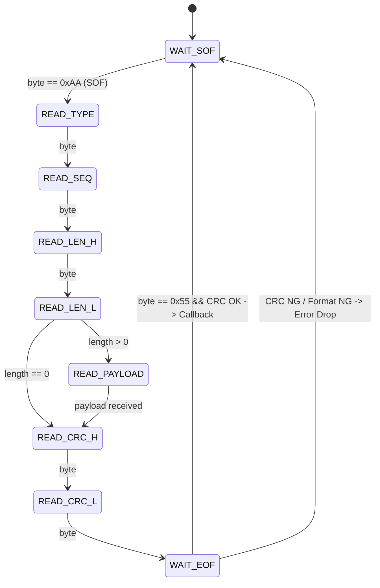

# uart_protocol (組み込み向けUART通信プロトコルスタック)

`uart_protocol` は、マイコン間通信やPC-マイコン間通信などのUARTシリアル通信において、高い信頼性と耐ノイズ性を提供する軽量プロトコルスタックライブラリです。

---

## 📑 目次
1. [特徴とメリット](#-特徴とメリット)
2. [フレーム構造とパケット仕様](#-フレーム構造とパケット仕様)
3. [パーサーステートマシン](#-パーサーステートマシン)
4. [C API リファレンス](#-c-api-リファレンス)
5. [C++ API リファレンス](#-c-api-リファレンス-1)
6. [リングバッファ (FIFO)](#-リングバッファ-fifo)
7. [実装例・ユースケース](#-実装例ユースケース)

---

## 🎯 特徴とメリット

- **ストリーム駆動ステートマシン**: 1バイト受信（UART割込みハンドラ `USART_IRQHandler` 等）から直接パーサーを駆動可能。
- **高信頼エラー検出**: CRC-16-CCITT（テーブル駆動による高速計算）により、伝送路上のノイズやビット化けを確実に検出・破棄。
- **軽量・ゼロ動的メモリ**: 静的バッファで動作し、`malloc` / `free` を一切使用しません。
- **標準パケットタイプ完備**: データ (`DATA`)、肯定応答 (`ACK`)、否定応答 (`NACK`)、疎通確認 (`PING`/`PONG`)、コマンド/レスポンス (`COMMAND`/`RESPONSE`) を標準サポート。
- **C/C++両対応**: 組み込みC言語APIに加え、ラムダ式で送受信ハンドラを記述できるモダンC++ラッパーを提供。

---

## 📦 フレーム構造とパケット仕様

```text
+------+------+------+------------+----------------+------------+------+
| SOF  | TYPE | SEQ  | LEN (2B)   | PAYLOAD (0..N) | CRC16 (2B) | EOF  |
| 0xAA | (1B) | (1B) | (Big-End)  | (LEN bytes)    | (Big-End)  | 0x55 |
+------+------+------+------------+----------------+------------+------+
```

| フィールド | バイト長 | 説明 |
| :--- | :--- | :--- |
| **SOF (Start of Frame)** | 1 | フレーム開始バイト (`0xAA`) |
| **TYPE** | 1 | パケット種別 (`0x01`: DATA, `0x02`: ACK, `0x04`: PING 等) |
| **SEQ** | 1 | シーケンス番号 (0〜255) |
| **LEN** | 2 | ペイロード長 (ビッグエンディアン, 最大 512 バイト) |
| **PAYLOAD** | 可変 (0〜512) | 送信バイナリデータ |
| **CRC16** | 2 | TYPE〜PAYLOAD末尾までの CRC-16-CCITT |
| **EOF (End of Frame)** | 1 | フレーム終了バイト (`0x55`) |

---

## 🔄 パーサーステートマシン



---

## 📖 C API リファレンス

### 初期化
```c
void uart_proto_init(uart_protocol_t *proto, uart_proto_tx_fn tx_fn, uart_proto_rx_callback rx_cb, void *user_data);
```

### 送信
```c
bool uart_proto_send(uart_protocol_t *proto, uint8_t type, const uint8_t *payload, uint16_t payload_len);
bool uart_proto_send_ack(uart_protocol_t *proto, uint8_t target_seq);
bool uart_proto_send_nack(uart_protocol_t *proto, uint8_t target_seq);
bool uart_proto_send_ping(uart_protocol_t *proto);
```

### 受信・パース
```c
// 1バイトずつ供給 (UART割込み用)
uart_parse_status_t uart_proto_parse_byte(uart_protocol_t *proto, uint8_t byte);

// 複数バイト一括供給
void uart_proto_process_bytes(uart_protocol_t *proto, const uint8_t *data, size_t length);
```

---

## ⚡ C++ API リファレンス

```cpp
#include "uart_protocol/uart_protocol.hpp"

uart_protocol::Protocol proto;

// 送信関数のバインド (ハードウェア送出)
proto.set_tx_handler([](const uint8_t *data, size_t len) {
    HAL_UART_Transmit(&huart1, data, len, 100);
});

// 受信ハンドラのバインド
proto.set_rx_handler([](const uart_packet_t &pkt) {
    if (pkt.type == UART_PKT_TYPE_COMMAND) {
        // コマンド処理
    }
});

// 送信
proto.send_string(UART_PKT_TYPE_DATA, "Hello MCU");
```

---

## 💡 実装例・ユースケース (マイコン割込み連携)

```c
#include "uart_protocol/uart_protocol.h"
#include "uart_protocol/uart_ringbuf.h"

static uart_protocol_t g_proto;
static uart_ringbuf_t g_rx_rb;
static uint8_t s_rx_buf[256];

void app_init(void) {
    uart_ringbuf_init(&g_rx_rb, s_rx_buf, sizeof(s_rx_buf));
    uart_proto_init(&g_proto, hardware_tx, on_packet_received, NULL);
}

// UART受信割込みハンドラ
void USART1_IRQHandler(void) {
    if (USART1->SR & USART_SR_RXNE) {
        uint8_t ch = (uint8_t)USART1->DR;
        uart_ringbuf_put(&g_rx_rb, ch);
    }
}

// メインループ
void app_loop(void) {
    uint8_t byte;
    while (uart_ringbuf_get(&g_rx_rb, &byte)) {
        uart_proto_parse_byte(&g_proto, byte);
    }
}
```
